# 从最初想法到代码结构

## 先看实验真正要证明的事

结合[现有需求](../requirements.md)，这个实验的核心是：**把大脑的决策和工具的执行分开部署，同时让大脑继续通过一个普通的 `Call` 接口使用工具。**

先把例子的输入读清楚：`message="A-only"` 是操作者填入的一段测试文字，换成“你好”也可以；`wait_ms=800` 表示等待 800 毫秒，也就是 0.8 秒。`A-only` 不是路由指令，选择 A 组用的是单独的 `-pair A` 参数。

当前“大脑”是 [`internal/app/brain.go`](../../internal/app/brain.go) 中写死步骤的 `RunBrain`，没有真实模型参与。两个工具分别是 `echo`（整份输入原样返回）和 `wait`（按给定时长等待）。这个例子可以读成：“先把这份数据原样送回来，再取出返回数据中的时长，执行一次等待。”

```text
操作者填写：文字 A-only，等待时长 800 毫秒
  → 调用 echo，输入 {"message":"A-only","wait_ms":800}
  → 得到相同的数据 {"message":"A-only","wait_ms":800}
  → 从这次返回中读取 wait_ms，得到 800
  → 调用 wait，输入 {"ms":800}
  → 工具等待后返回 {"waited_ms":800}
  → 大脑汇总两次结果
```

`800` 是操作者提前给的；这里的“决策”具体只是读取前次结果、生成下次参数，工具顺序固定为 echo → wait。这样可以观察两次调用之间的数据衔接，以及本地／远程执行是否能复用同一段流程。

**先读[从输入开始的完整例子](07-concrete-call-walkthrough.md)**：逐步列出大脑、网关、执行端各自调用的函数、输入与输出，再回来看下面的接口会更容易。

[`executor.go`](../../internal/endpoint/executor.go) 的接口就是两种执行方式的共同入口：

```go
type Executor interface {
    Call(ctx context.Context, tool string, input json.RawMessage) (json.RawMessage, error)
}
```

`RunBrain` 只依赖这个接口。启动时装配 `LocalExecutor` 或 `RemoteExecutor`，决定调用是在本进程执行，还是通过网关送到另一个进程。

## 进程、角色和对象不要混在一起



[Mermaid 图源](diagrams/01-architecture.mmd)。图中 WS 箭头表示连接建立后的双向通信；两端都主动拨号连接网关。

远程 A/B 实验通常启动五个进程：一个 Gateway、两个 Brain、两个 Executor。它们运行的是同一个 Go 程序，用子命令选择角色。Local 模式只需一个 Brain 进程。

**容易读反的名字是 `RemoteExecutor`：它在 Brain 进程内，是“替大脑调用远端工具的代理”。真正接收请求、运行工具的是另一个进程中的 `ExecutorEndpoint`。**

另一个容易误解的名字是 `Client`：Brain 和 Executor 都是网关的 WebSocket 客户端，所以两边复用这份代码。“执行端”在业务上执行任务，在网络连接上仍然是客户端。

## 职责怎样分层

| 层次 | 代码 | 这一层回答的问题 |
| --- | --- | --- |
| 启动装配 | `internal/app/app.go`：`Main`、`run`、三个 `run*Command` | 启动哪个角色？选哪个 pair？凭证从哪里读取？ |
| 大脑决策 | `internal/app/brain.go`：`RunBrain` | 先用什么工具？怎样根据前一次结果决定下一步？ |
| 统一执行接口 | `internal/endpoint/executor.go`：`Executor` | 大脑如何调用工具并拿到结果或错误？ |
| 本地执行 | `internal/endpoint/executor.go`：`LocalExecutor.Call` | 在当前进程运行工具，限制一次只能执行一个。 |
| 远程调用代理 | `internal/endpoint/executor.go`：`RemoteExecutor` | 给调用编号、登记等待、发送请求、匹配返回、裁定超时。 |
| 两端共用通信层 | `internal/endpoint/client.go`：`Client`、`Channel` | 连接是否可用？现在是哪一轮通道？失联后是否还能重拨？ |
| 网关 | `internal/gateway/gateway.go`：`Gateway`、`PairRoute` | 接入者是谁？属于哪一组？消息能否发给该组当前对端？ |
| 执行端 | `internal/endpoint/executor_endpoint.go`：`ExecutorEndpoint` | 有没有空闲执行槽？运行哪个工具？结果还属于有效通道吗？ |
| 工具本身 | `internal/endpoint/tools.go`：`ExecuteTool` | echo 原样返回；wait 等待或响应取消。 |
| 消息格式 | `internal/transport/protocol.go`：`Envelope`、`ToolMessage` | 网关需要看什么？两端需要看什么？ |
| 连接保活 | `internal/transport/heartbeat.go`：`HeartbeatContext` | 这一条 WS 是否还能收到 Pong？ |

根目录 `main.go` 只调用 `app.Main`。依赖方向是 `app → gateway / endpoint → transport`：启动装配留在 app，网关和端点各管自己的状态，共用协议与 WS 辅助函数放在 transport。仍然是一个程序、三种角色。

## 网关眼中的系统很简单

可以把 [`gateway.go`](../../internal/gateway/gateway.go) 中的数据结构展开成这样：

```text
Gateway.Pairs
├─ "A" → PairRoute
│         ├─ tokens["brain"], tokens["executor"]  固定角色凭证
│         ├─ Peers["brain"], Peers["executor"]    当前接入记录
│         ├─ Epoch                              当前通道标识
│         └─ Mu                                 A 组自己的锁
└─ "B" → PairRoute
          └─ 同样一套独立状态
```

网关知道哪一组、哪个角色、当前连接和 epoch；它没有 `PendingCall`，也没有工具执行表、结果表。`body` 的工具含义只由端点解释。

每组自己的锁把登记、状态发送、转发和清理排出顺序。当前实现会持该组锁写消息，单次写入受 2 秒上限约束。A 的这把锁不会把 B 的转发串行化；但各组仍共享进程和机器资源，不能据此推导出无限的性能隔离。

## 什么复杂度来自原始目标，什么来自故障处理

| 代码机制 | 解决的具体事情 |
| --- | --- |
| `Executor` 接口 | 让同一段大脑流程切换本地与远程执行。 |
| `pair` 和两端凭证 | 确定大脑的固定执行端，A/B 不串线。 |
| `id`、`pending` | 远程结果到来时，交还给正确的一次 `Call`。 |
| `epoch`、`channel` 身份检查 | 重连或换代后，旧消息、旧清理不能影响新的通信。 |
| 各层 `ctx` | 端点停止、连接失联、通道失效、调用超时分别终止相应工作。 |
| `slot` | 即使旧工具不响应取消，也不能假装它已经释放执行能力。 |
| 心跳、有限重拨 | 发现没有明确断开事件的失联，并在有限范围内恢复通信。 |

因此阅读时可以先暂时跳过故障分支，沿一次正常 `Call` 走通，再逐个补回上述机制。后面的图按这个顺序展开。

当前实验不接真实模型或 Shell，也不做业务消息缓存、重放、持久化或流式输出。`stream-gateway-lab` 这个工程名不能用来推断当前已有这些能力。
