# ctx：谁的工作还有效，谁可以要求它结束

## 不要只把 ctx 翻译成“上下文”

在这个实验里，读到 `ctx` 时，把它展开成三个问题更有用：

1. 这段工作是否已被要求停止？`ctx.Done()` / `ctx.Err()`。
2. 最晚什么时候停止？`ctx.Deadline()`。
3. 停止的具体原因是什么？`context.Cause(ctx)`。

当前工程没有借助 `ctx.Value` 存储 pair、请求参数或路由。`ctx` 不是调用数据包，也不是某个万能“会话对象”。

常见代码可以这样读：

```go
ctx, cancel := context.WithTimeout(ctx, callTimeout)
defer cancel()
```

“以传入的 ctx 为父级，派生一个最多活 15 秒的子 ctx；本函数结束时释放它的计时与取消资源。”后续局部变量 `ctx` 指向的是子 context；不是把调用者手里的父 context 改成了 15 秒。父级如果更早到期，子级也随之结束。

## 先看实际的父子关系



[Mermaid 图源](diagrams/02-context-tree.mmd)。实线表示 `WithCancelCause` / `WithTimeout` 等建立的 context 父子关系。Brain 部分按默认一次性 CLI 绘制。

**`channel.ctx` 和连接读循环 ctx 都直接派生自 `client.ctx`，两者是兄弟关系。** 通道 ctx 没有直接挂在读循环 ctx 下面；读循环退出后，由 `client.run` 调用 `invalidateLocked` 显式取消旧通道。

这也解释了为何一条健康 WS 可以经历多个 epoch：对端换了，旧 `channel.ctx` 要取消；本端的读循环仍可继续读同一条 WS。

Brain 的调用 ctx 则来自 `Call` 的调用者，不是自动派生自 `s.ctx`。`waitResult` 同时监听这两条信号，任何一条结束都会终止本次等待。

`-stdin` 模式的父级有一处变化：`run` 把 `remote.client.ctx` 传给 `runBrainInput`，后者再派生输入循环 ctx，然后传给 `runBrain` / `Call`。因此重连耗尽导致 client 停止时，等待输入的 Brain 也能退出。它和单次调用 ctx 仍不是同一个对象。

## 每一个 ctx 管什么

| context 的创建处 | 建议读法 | 什么时候结束 | 直接影响 |
| --- | --- | --- | --- |
| `main`：`signal.NotifyContext` | 这个 CLI 进程的运行期限 | SIGINT、SIGTERM 或退出清理 | 本进程由它派生的工作收到取消。 |
| `newClient`：`WithCancelCause` | 这个逻辑端点的总寿命 | 父级取消、终止性错误、等待对端超时、重拨额度耗尽 | 结束重连循环、读循环和通道等子工作。 |
| `client.run`：`dialCtx` | 这一次拨号的期限 | 最多 5 秒，或父级结束；拨号返回后调用 cancel | 约束拨号；不是后续所有工具调用的期限。 |
| `readConnection`：`heartbeatContext(c.ctx, conn)` | 这一条 WS 读循环／保活的寿命 | 心跳失败、等对端超时、父级取消或函数清理 | 退出此连接的读取，再作废通道并决定是否重拨。 |
| `readConnection`：`channelCtx` | 本端这一个 epoch 的有效期 | 收到空／不同 epoch、连接失效、主动断开或端点停止 | Brain 的旧等待失败；Executor 的旧 toolCtx 收到取消。 |
| `RemoteExecutor.Call`：`WithTimeout` | Brain 愿意等这一次调用多久 | 调用者取消／期限、最多 15 秒、函数返回清理 | `waitResult` 结束等待；到期／取消分支会尝试断开原通道。 |
| `executorEndpoint.receive`：`toolCtx` | 这个工具在这轮通道中的执行期限 | `s.ctx` 取消、收到的剩余预算到期、工具返回清理 | 合作工具停止；不合作工具仍可能继续执行。 |
| `LocalExecutor.Call`：`WithTimeout` | 本地工具的执行期限 | 调用者结束、最多 15 秒、函数返回清理 | 当前合作式模拟工具响应取消。 |
| 网关 `ServeHTTP` 的 `heartbeatContext(r.Context(), conn)` | 网关所见这一条入站 WS 的寿命 | 请求／连接结束、心跳失败等 | 结束该端读取，清理该端接入记录。 |
| `writeFrame`：`WithTimeout` | 这一次写消息的期限 | 父级取消或最多 2 秒 | 结束写入，由调用方处理错误。 |
| `heartbeatContext` 的 `pingCtx` | 这一次 Ping 的期限 | 父级结束或最多 2 秒 | Ping 失败时触发该连接的失联处理。 |

补充：`pairRoute.remove` 通知健康对端时，`writeFrame` 的父级是 `context.Background()`，仍由 `writeFrame` 加上 2 秒上限。离线端的请求 context 可能已结束，不能拿它来阻止给健康端发送离线通知。

## 取消不会自动穿过网络

Brain 的 `ctx` 和 Executor 的 `toolCtx` 位于不同进程，彼此没有 Go context 的父子关系。消息里传递的只是 `timeout_ms`；执行端收到后创建自己的计时器。



[Mermaid 图源](diagrams/03-cancellation.mmd)。这张图专门展示 Brain 的 `waitResult` 观察到本地调用超时／取消的路径。

代码路径是：

```text
Brain Call 的 ctx 到期
→ waitResult 检查到 ctx.Err()
→ client.disconnect(当初的 channel, 原因)
→ 确认仍是当前通道，作废它并关闭它的 WS
→ Gateway 发现这一端断开，清空该组 epoch，通知健康对端
→ Executor 收到空 epoch，取消旧 channel.ctx
→ 以旧 channel.ctx 为父级的 toolCtx 也取消
→ wait 工具的 select 观察到 Done，返回
```

执行端也有自己的超时计时器，可能先到期并返回工具错误。于是 Brain 有时看到 `tool failed: context deadline exceeded`，有时走本地超时分支得到 `context deadline exceeded`，取决于哪个事件先被处理。前者不必经过上图的主动断开路径。

`timeout_ms` 是 Brain 发送前算出的剩余预算，不是跨机器共享的绝对截止时间。Executor 从创建 toolCtx 时开始计时，网络和调度耗时会造成偏差；Brain 仍以自己的 deadline 裁定等待是否过期。

## cancel 的效果是通知，不是强杀 goroutine

[`tools.go`](../../tools.go) 中的 wait 合作响应取消：

```go
select {
case <-ctx.Done():
    return nil, ctx.Err()
case <-timer.C:
    // 返回等待结果
}
```

如果某个工具完全不检查 ctx，调用 `cancel` 不会让 Go 强制终止它。当前执行端因此把 `slot.Unlock()` 放在 `e.execute(...)` **真正返回之后**。

| 事件 | 能说明什么 | 不能说明什么 |
| --- | --- | --- |
| Brain 的 Call 返回失败 | Brain 已不再等待本次结果，pending 将被清除。 | 工具一定未执行，或已停止。 |
| toolCtx 的 Done 被关闭 | 已请求工具结束，其期限／通道已无效。 | 工具已经执行完退出清理。 |
| 新 epoch 就绪 | 新一轮通信可以收发。 | 旧工具已释放执行槽。 |
| `e.execute` 返回、slot 解锁 | 实际执行名额可再使用。 | 旧操作的外部副作用已回滚。 |

`context.AfterFunc(toolCtx, ...)` 在执行端这里只打印取消原因。它不会替工具做终止，也不会释放 slot。

## 读 ctx 代码的两个小技巧

首先顺着创建处找父级：看到 `WithTimeout(s.ctx, ...)`，就知道这个工具属于原通道；看到 `WithTimeout(c.ctx, ...)`，就知道它属于端点整体寿命下的一段工作。

其次分清 `Err()` 和 `Cause()`：前者通常给出 `context canceled` 或 `context deadline exceeded` 这样的标准结果；后者还能保留 `WithCancelCause` 传入的具体失效原因，例如 `channel lost: ...`。本工程用具体原因帮助判断是普通取消，还是通道失联。

本节依据：[`client.go`](../../client.go)、[`executor.go`](../../executor.go)、[`executor_endpoint.go`](../../executor_endpoint.go)、[`heartbeat.go`](../../heartbeat.go)、[`main.go`](../../main.go)。
