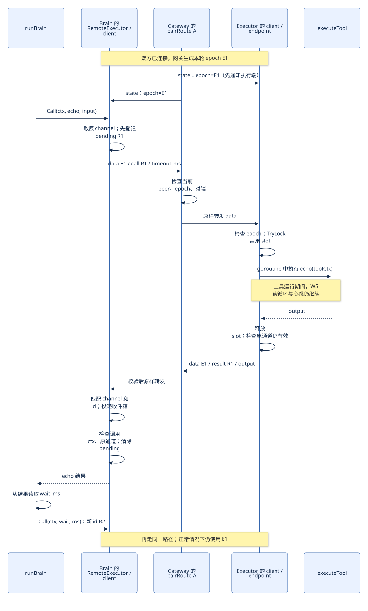
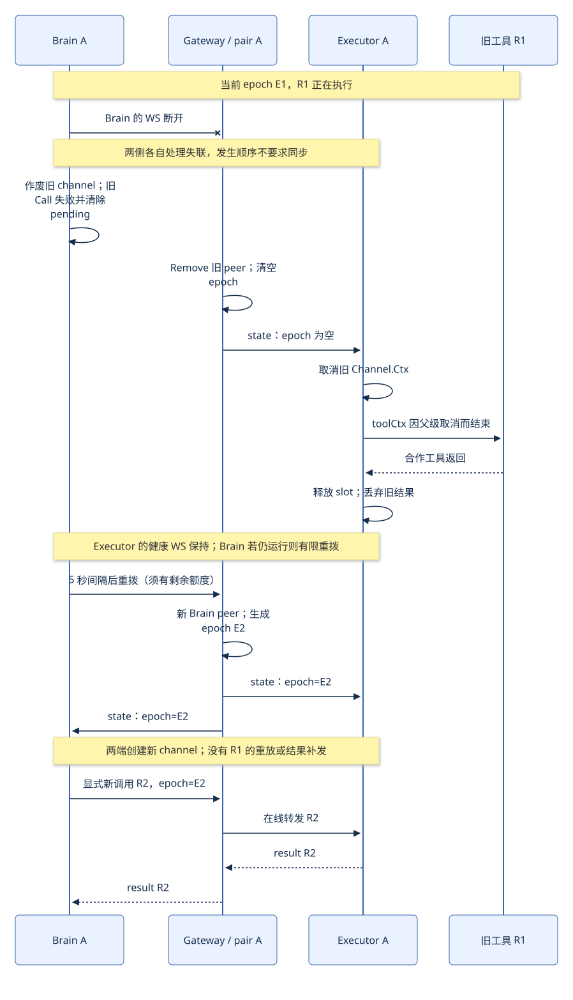

# 一次调用怎样走完，断线后又发生什么

## 先认出线上两层消息

外层 `Envelope` 由通信层处理，内层 `ToolMessage` 由 Brain 和 Executor 处理。定义都在 [`protocol.go`](../../internal/transport/protocol.go)。

双方配齐后，网关发送状态：

```json
{"type":"state","epoch":"E1"}
```

Brain 发送 echo 请求，例如：

```json
{
  "type": "data",
  "epoch": "E1",
  "body": {
    "kind": "call",
    "id": "R1",
    "tool": "echo",
    "input": {"message": "A-only", "wait_ms": 800},
    "timeout_ms": 14999
  }
}
```

Executor 返回：

```json
{
  "type": "data",
  "epoch": "E1",
  "body": {
    "kind": "result",
    "id": "R1",
    "output": {"message": "A-only", "wait_ms": 800}
  }
}
```

这里 E1、R1 为讲解代号，14999 为示例剩余毫秒数。实际字段名与格式对应当前代码。失败结果用 `error` 替代 `output`，例如 `"error":"executor busy"`。

| 问题 | 谁负责回答 |
| --- | --- |
| 发件人属于 A 还是 B，能发给谁？ | 接入时的 pair、role、token 与网关路由。 |
| 这条 data 还属于当前有效通信吗？ | 外层 epoch 与当前连接检查。 |
| 应执行哪个工具、怎样解释 input？ | Executor 解释 body。 |
| 应把 result 交给哪次调用？ | Brain 的 pending 与 body.id。 |

客户端不能发 `state` 冒充网关；网关读到非 `data` 的应用消息会结束该连接。心跳使用 WS Ping/Pong 控制帧，不属于上面的 JSON 消息。

## 场景一：正常 echo → wait



[Mermaid 图源](diagrams/04-normal-call.mmd)。图中把每一端的 client 与业务适配对象合并为一个参与者，以便先看消息流。

按代码跟一次 echo：

1. `app.runBrainCommand` 装配 `RemoteExecutor`。`NewRemoteExecutor` 启动 client 的读取／重连循环，并在启动阶段 `WaitReady`。
2. 网关在双方配齐后生成 E1，**先给 Executor 发 state，再给 Brain 发 state**。这样工具请求不会先于执行端的通道状态到达。
3. `RunBrain` 调用 `RemoteExecutor.Call`。它创建本次调用期限，取得当前 channel 引用 `s`。
4. `Call` 先登记 `pending={id:R1, channel:s, result:收件箱}`，再发送。否则 echo 太快时，结果可能先于等待记录到达。
5. `Client.Send` 检查 `s` 仍是当前有效通道，装上 epoch，用 WS 发出 data。
6. 网关校验当前接入对象、epoch 和对端连接，将整条 data 原样转发，不理解 echo。
7. Executor 的 `Client.readConnection` 再核对本端连接与 epoch，然后调用 `ExecutorEndpoint.Receive`。拿到 slot 后启动 goroutine 执行工具，读循环继续收消息和处理心跳。
8. 工具返回后，执行端释放 slot。原通道失效就丢结果，否则带着**原来的 s** 发送 R1 的 result。
9. Brain 读循环把结果交给 `RemoteExecutor.Receive`，匹配原 channel 和 R1 后放入 Pending.Result。
10. `WaitResult` 统一检查调用期限、原通道是否失效，再接受结果。`Call` 返回时清空 pending。

`RunBrain` 再从 echo 的输出读取 `wait_ms`，发起另一次 wait。它有新的调用 id，但正常情况下继续使用 E1。

“启动时等就绪”和“调用时等上线”要区分：构造 RemoteExecutor 时可以等对端；已有代理在离线期间收到 Call，会立即返回 `endpoint unavailable`，不会把新业务请求放进队列。

## 场景二：Brain 断线，Executor 的 WS 仍健康



[Mermaid 图源](diagrams/05-recovery.mmd)。图示假设端点进程仍运行、旧工具响应取消，且重拨尚有额度；恢复后显式发起新调用。

断线会触发两个本地处理过程，它们不要求瞬间同时完成：

- Brain 的读取失败后，`Client.Run` 作废旧 channel；`WaitResult` 因 `s.Ctx.Done()` 返回失败，清除旧 pending。
- 网关 `PairRoute.Remove` 删除离线 Brain 的 peer，清空 epoch，向健康 Executor 发 `{"type":"state","epoch":""}`。Executor 作废旧 channel，其 toolCtx 收到取消。

Brain 若仍在运行，则按固定间隔、有额度地重拨。Executor 的 WS 可以继续使用。双方重新配齐时，网关生成 E2；两端分别创建新的 channel 对象。

**旧调用的结果不会因为 E2 恢复就重新有效。** E2 上的操作必须是新的显式 Call，有新的 id。

CLI 的默认 Brain 只跑一轮 `RunBrain`，调用失败后可能直接退出，不会保持进程等你再次调用。手工验证同一 Brain 恢复后接新任务，使用根 [README](../../README.md) 中的 `-stdin` 模式；测试则在同一进程保留代理对象。

如果没有收到空 epoch，直接收到不同的非空 E2，也会先取消 E1，再创建 E2。这个分支由 `Client.readConnection` 中的 epoch 不等判断实现。`TestEpochAndLateEvents/same-sockets` 专门在两条 WS 都不变的情况下测试它；这是测试注入，不是产品暴露了“手动换代”接口。

## 场景三：通道恢复了，但旧工具不肯停

此时的状态可能是：

```text
Brain：R1 已失败，pending 已释放
网络：E2 已就绪，可以发送新消息
Executor：旧 R1 的 toolCtx 已取消，但工具函数还没返回
          slot 仍被旧工具持有
```

新 R2 能到达 Executor，但 `slot.TryLock()` 失败，立即回复 `executor busy`；它不会排队，更不会偷偷在旧工具结束后执行。旧工具真正返回时释放 slot，旧结果因 E1 失效被丢弃。再发起一个新调用才可能成功。

这就是为什么既要有 Brain 的 `pending`，又要有 Executor 的 `slot`：一个表示“有人正在等结果”，一个表示“真的还有工具在跑”。跨进程故障下，这两个状态可以不同步。

## 场景四：结果和超时几乎同时到达

`select` 在多个分支都就绪时，不保证优先挑超时。因此 `WaitResult` 不能把“从收件箱读到结果”直接当成成功。

现在的顺序是：

```text
等待：调用 ctx / 原通道 ctx / 结果收件箱，任意一个唤醒
    ↓
调用 ctx 已结束？ → 尝试断开原通道，返回超时或取消
    ↓ 否
原通道已有失效原因？ → 返回通道错误
    ↓ 否
result.error 非空？ → 返回工具错误
    ↓ 否
返回 result.output
```

判断点是这次终态检查，不是按网络包到达时间做全局排序。检查时调用 ctx 已超时，即使成功结果已经在收件箱里，也会返回超时；已经返回的成功不会被后来发生的超时改写。

## 旧事件分别在哪些地方被拦住

| 防线 | 代码位置 | 避免的具体问题 |
| --- | --- | --- |
| 发送绑定原 channel | `Client.Send` | 旧工具不能拿自己的旧 s 借用新通道发结果。 |
| 网关检查 peer、epoch、对端 | `PairRoute.ServeHTTP` | 旧接入或旧 epoch 的 data 不能被转发到当前对端。 |
| 接收检查 conn、epoch | `Client.readConnection` | 已经在网络中的旧 data 到达后仍不能进入当前处理函数。 |
| 交付检查 Pending.Channel、id | `RemoteExecutor.Receive` | 同 epoch 的旧 id，或带新 id 的旧 channel 回调，不能结束新调用。 |
| 清理检查当前 channel 和 conn | `Client.Disconnect` | 旧调用的迟到超时／清理不能关掉新通道，哪怕复用了同一 WS。 |
| 删除检查当前 peer 身份 | `PairRoute.Remove` | 旧连接的迟到清理不能删掉替换后的新 peer。 |

这不是用很多编号重复解决同一件事：pair 管路由归属，epoch 管通信轮次，id 管一次调用，对象身份管本地迟到回调。

网关对格式合法但 epoch 等条件不匹配的 data 直接丢弃，没有单独的拒收业务 ACK。调用方通过通道状态／断线结束等待，调用超时负责兜底。“无缓存”也不等于完全没有内存状态：当前路由、pending 和容量为 1 的结果收件箱都服务于当下通信，不用于离线恢复。
