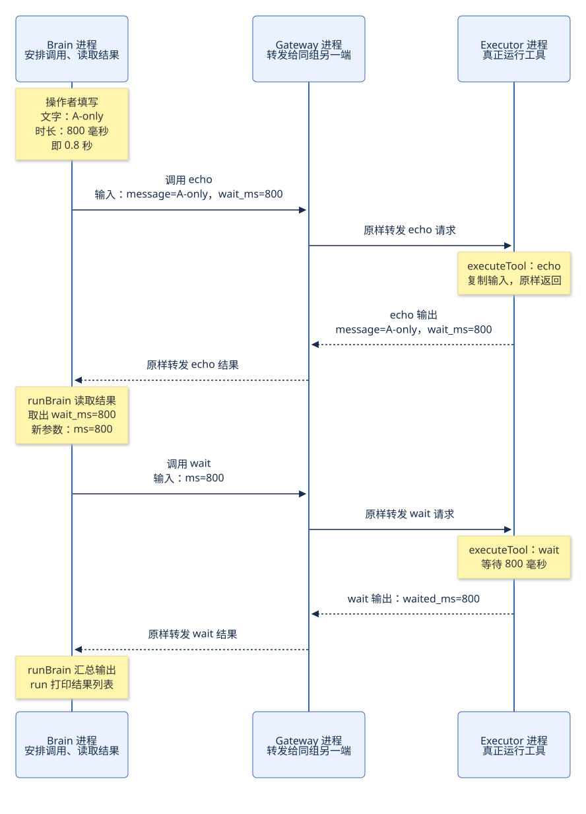

# 先解释输入，再走完一次 echo → wait

源码核对：2026-10-18。本篇只走正常成功路径，先把“程序到底在做什么”讲清楚。

## 1. `message="A-only", wait_ms=800` 到底是什么意思

这是**操作者给实验程序填写的两项输入**，并不是一条需要大模型理解的自然语言指令。

| 写法 | 用普通话读出来 | 程序怎样使用它 |
| --- | --- | --- |
| `message` | “我要让程序原样返回的那段文字” | 作为输入数据传给 echo 工具。 |
| `"A-only"` | “文字内容是 A-only” | 一段测试文字；换成 `"你好"` 也可以，程序不理解它的英文含义。 |
| `wait_ms` | “这次实验希望等待多少毫秒” | 先随其他数据一起送给 echo；大脑从 echo 的返回中取出这个值，再交给 wait 工具。 |
| `800` | “800 毫秒，也就是 0.8 秒” | 由操作者预先指定，不是大脑计算或推理出来的。 |

所以这个例子表达的实验是：

> 我给程序一份数据：文字是 A-only，等待时长是 0.8 秒。让程序先把整份数据原样送回来，再按送回来的时长执行一次等待，最后把两次结果列出来。

`A-only` 的字面意思容易让人以为它是一条“只发给 A”的指令。**代码不把它当作路由指令。选择 A 组使用的是另一个启动参数 `-pair A`。** 即使文字写成 B-only，只要选择的仍是 A 组，消息仍发给 A 组执行端。

暂时不看网络，可以直接运行：

```sh
go run . brain -mode local -message A-only -wait-ms 800
```

读法：启动大脑，用本地方式执行工具；测试文字填 A-only，等待时长填 800 毫秒。

[`main.go`](../../main.go) 的 `run` 读取命令行参数，然后调用：

```go
runBrain(ctx, executor, "A-only", 800)
```

`-wait-ms` 是命令行参数名，`waitMS` 是 Go 函数里的变量名，`wait_ms` 是生成的 JSON 字段名。在这里它们承载同一个输入值 `800`。

## 2. 所谓“大脑”，现在实际是一段写死顺序的程序

当前没有真实模型参与。`runBrain` 固定先调用 echo，再调用 wait。这里把它叫作“大脑”，是因为它负责组织工具调用步骤、读取结果并生成下一次调用参数。

两个工具都很简单，实现在 [`tools.go`](../../tools.go) 的 `executeTool`：

| 工具 | 普通话含义 | 输入 | 执行的事 | 成功输出 |
| --- | --- | --- | --- | --- |
| `echo` | 回声：给我什么，就回什么 | `{"message":"A-only","wait_ms":800}` | 复制整份输入，原样返回；不会等待 800 毫秒 | `{"message":"A-only","wait_ms":800}` |
| `wait` | 等待 | `{"ms":800}` | 设置一个 800 毫秒的定时器，等它到期 | `{"waited_ms":800}` |

**文字 A-only 到 echo 原样返回这一步，就完成了它在本次流程中的作用。** 第二个工具只收到等待时长，不收到这段文字。

先不考虑网络，`runBrain` 的全部业务动作如下：

| 顺序 | 大脑做什么 | 对应代码 | 这一刻得到什么 |
| --- | --- | --- | --- |
| 1 | 把操作者给的两项输入写成 JSON | `json.Marshal(brainInput{message, waitMS})` | `input = {"message":"A-only","wait_ms":800}` |
| 2 | 请 echo 原样返回这份数据，并等待结果 | `executor.Call(ctx, "echo", input)` | `echo = {"message":"A-only","wait_ms":800}` |
| 3 | 从返回的数据中读取等待时长 | `json.Unmarshal(echo, &decision)` | `decision.WaitMS = 800`；这个结构只取 `wait_ms` 字段 |
| 4 | 把时长写成 wait 工具要求的参数格式 | `json.Marshal(map[string]int{"ms": decision.WaitMS})` | 新的 `input = {"ms":800}` |
| 5 | 请 wait 等待 800 毫秒，并等待结果 | `executor.Call(ctx, "wait", input)` | `wait = {"waited_ms":800}` |
| 6 | 把两次工具输出装进结果列表 | `return []observation{{"echo", echo}, {"wait", wait}}, nil` | 返回两条记录；随后 `run` 把它们打印到终端 |

其中第 2、5 步的 `Call` 都要等到本次工具的结果或错误出现，才返回给 `runBrain`。第 2 步若失败，后面的 wait 就不会发起。

`wait_ms` → `ms` → `waited_ms` 不是三个不同的时长：分别是**实验输入字段、wait 工具的入参字段、wait 工具的结果字段**。本例里都是 `800`。`waited_ms` 直接填写请求的时长，不是测量出来的端到端耗时；真实耗时还会受调度和通信影响。

## 3. 为什么要先 echo，再 wait

从业务实用性看，确实可以直接拿操作者输入的 `800` 去等待。这里故意让数据先经过一次工具调用，再从工具结果中取值，形成下面这种关系：

```text
操作者输入 800
    ↓
第一个工具返回的数据里带着 800
    ↓
大脑读取这个返回值，生成第二个工具的参数 {"ms":800}
    ↓
第二个工具执行等待
```

它用最简单的数据演示“**获得前一个工具的结果后，再发起下一次工具调用**”。结合[需求中的统一调用接口目标](../requirements.md)，可以检查：换成本地执行或通过网关远程执行以后，这段组织步骤、消费结果的代码能否保持相同。

此前文档使用“根据 800 决定下一步等待多久”，容易让人以为存在复杂推理。更准确的说法是：**程序从 echo 返回的数据里读取 `wait_ms`，把它填到 wait 的 `ms` 中。工具顺序是写死的，数字也是操作者提前给的。**

以上是对当前模拟流程作用的解释，不把它当作真实智能体推理能力的验证。

## 4. 切到远程以后，三个进程分别负责什么

在已按[项目 README](../../README.md)配置并启动网关、A 组执行端后，大脑的启动参数可以是：

```sh
go run . brain -mode remote -pair A -message A-only -wait-ms 800
```

`runBrain` 得到的文字和时长没变，变化的是传进去的 `executor` 对象。

| 运行位置 | 对象／函数 | 普通话职责 |
| --- | --- | --- |
| Brain 进程 | `runBrain` | 安排先 echo、再 wait，消费两次结果。 |
| Brain 进程 | `RemoteExecutor.Call` | 把一次工具调用变成网络请求，等待对应结果，再交回大脑。**这个对象在大脑这一侧。** |
| Gateway 进程 | `pairRoute.ServeHTTP` | 检查本组的连接与通道状态，把消息送给本组另一端。 |
| Executor 进程 | `executorEndpoint.receive` | 收到调用要求，安排执行工具，随后发送结果。 |
| Executor 进程 | `executeTool` | 真正执行 echo 或启动定时器等待。 |

`Executor` 是接口，意思是“大脑拿到的对象必须有一个 `Call` 方法”。启动代码 `run` 把 `executor` 设成 `RemoteExecutor` 后，`runBrain` 写的 `executor.Call(...)` 就会进入 `RemoteExecutor.Call`。它不会直接进入另一进程的函数；中间通过网络发送 JSON，另一进程收到后自行调用函数。

下图假设双方已连接、A 组可以通信。为先看清业务，图中省略外层通道标识和调用编号；后面给出消息格式。



[可编辑 Mermaid 图源](diagrams/06-concrete-example.mmd)。两次请求都是大脑发起的，网关不会在 echo 完成后自行安排 wait。

## 5. 第一趟：把数据原样送回来

下面沿 `Call(ctx, "echo", input)` 走到底。这里只展开成功路径。

| 顺序 | 在哪里、哪个函数 | 收到什么 | 做什么、把什么交给下一步 |
| --- | --- | --- | --- |
| 1 | Brain：`runBrain` | 文字 A-only、时长 800 | 调用 `executor.Call(ctx, "echo", {"message":"A-only","wait_ms":800})`。 |
| 2 | Brain：`RemoteExecutor.Call` | 工具名 echo 和上述 JSON | 生成本次调用编号，登记“我正在等这次结果”，组装 `kind:"call"` 消息；调用 `client.send`，然后在 `waitResult` 等结果。 |
| 3 | Brain：`client.send` → `writeFrame` | 内层调用消息 | 加上当前通道的外层信息，写入 Brain 到网关的 WebSocket。发送函数只返回是否发送出错，不返回工具输出。 |
| 4 | Gateway：`pairRoute.ServeHTTP` 的读循环 → `writeFrame` | 完整的网络消息 | 检查它属于 A 组当前有效通道，原样转发到 Executor A 的连接；不解释 echo 或 800。 |
| 5 | Executor：`client.readConnection` | 网关转来的同一消息 | 校验外层信息，将 `body` 交给 `executorEndpoint.receive`。 |
| 6 | Executor：`executorEndpoint.receive` | 工具名 echo、输入数据、调用编号和超时预算 | 检查可执行后启动一个 goroutine，在里面调用 `e.execute(toolCtx, call.Tool, call.Input)`。`runExecutor` 已把 `e.execute` 设为 `executeTool`。 |
| 7 | Executor：`executeTool` 的 `case "echo"` | `{"message":"A-only","wait_ms":800}` | 复制这份 JSON，作为函数返回值交回工具 goroutine。 |
| 8 | Executor：工具 goroutine → `client.send` | echo 的输出 | 组装带同一个调用编号的 `kind:"result"` 消息，`output` 填入原样返回的数据，经 WebSocket 发给网关。 |
| 9 | Gateway：Executor 连接对应的 `pairRoute.ServeHTTP` 读循环 | 结果消息 | 检查当前通道，原样转发给 Brain A。 |
| 10 | Brain：`client.readConnection` → `RemoteExecutor.receive` | echo 的结果消息 | 确认结果属于当前等待的那次调用，把消息放进它的 `pending.result` 收件箱。 |
| 11 | Brain：`RemoteExecutor.waitResult` → `RemoteExecutor.Call` | 收件箱里的结果 | 确认没有超时或通道失效后，返回 `result.Output`；`Call` 结束，清除本次等待记录。 |
| 12 | Brain：`runBrain` | `echo = {"message":"A-only","wait_ms":800}` | 第一条 `Call` 到此才成功返回。接着读取 `echo` 中的 `wait_ms`。 |

注意第 6 步：`executorEndpoint.receive` 启动工具 goroutine 后就返回 `nil`，让连接继续接收消息。**工具结果是第 8 步另外发送的网络消息，不是 `receive` 的函数返回值。**

相关源码：[`executor.go`](../../executor.go)、[`client.go`](../../client.go)、[`gateway.go`](../../gateway.go)、[`executor_endpoint.go`](../../executor_endpoint.go)、[`tools.go`](../../tools.go)。`writeFrame` 虽然定义在 `gateway.go`，两端的 `client.send` 也会调用它；文件名不决定函数在哪个进程运行。

## 6. 网络上实际装了什么

为方便阅读，把本次通道标识记作 `E1`，echo 调用编号记作 `R1`。实际运行中这两个值是随机字符串。下面是按当前结构写出的格式示例，不是抓包记录；`timeout_ms:14999` 是示意的剩余时间预算，运行时计算，不固定。

Brain → Gateway → Executor，转发的是同一份消息：

```json
{
  "type": "data",
  "epoch": "E1",
  "body": {
    "kind": "call",
    "id": "R1",
    "tool": "echo",
    "input": {"message": "A-only", "wait_ms": 800},
    "timeout_ms": 14999
  }
}
```

Executor → Gateway → Brain，返回消息是：

```json
{
  "type": "data",
  "epoch": "E1",
  "body": {
    "kind": "result",
    "id": "R1",
    "output": {"message": "A-only", "wait_ms": 800}
  }
}
```

`wait_ms:800` 是这次业务希望等待的时长。`timeout_ms` 是本次工具调用的执行时间预算，两者用途不同；echo 会原样返回 `800`，不会因此执行等待。

网关从连接建立时的 `pair=A` 知道该送到 A 组的哪一端。它不从 `message` 猜目的地，也不解析 `body` 中的工具含义。消息结构定义见 [`protocol.go`](../../protocol.go)；外层 `epoch` 的解释见[专题](06-epoch-explained.md)。

## 7. 第二趟：拿到 800 后，执行等待

第一趟返回后，`runBrain` 的 `json.Unmarshal(echo, &decision)` 得到 `decision.WaitMS = 800`，然后生成 `{"ms":800}`，调用：

```go
executor.Call(ctx, "wait", input) // 此时 input 是 {"ms":800}
```

第二趟仍走第 5 节的同一串函数。具体数据变成：

| 位置 | 这一次的动作和数据 |
| --- | --- |
| Brain 的 `RemoteExecutor.Call` | 新生成调用编号 `R2`；发送的 `body` 是 `{"kind":"call","id":"R2","tool":"wait","input":{"ms":800},"timeout_ms":14999}`，其中预算仍只是示例。 |
| Gateway 的 `pairRoute.ServeHTTP` | 把这份请求原样转给 Executor A。网关不启动 800 毫秒的定时器。 |
| Executor 的 `client.readConnection` → `executorEndpoint.receive` | 收到 wait 请求，安排执行 `executeTool(toolCtx, "wait", {"ms":800})`。 |
| Executor 的 `executeTool` | 解析 `ms=800`；调用 `time.NewTimer(800 * time.Millisecond)`；定时器到期后返回 `{"waited_ms":800}`。 |
| Executor 的工具 goroutine → `client.send` | 发出 `body = {"kind":"result","id":"R2","output":{"waited_ms":800}}`。 |
| Gateway 的 `pairRoute.ServeHTTP` | 把结果原样转回 Brain A。 |
| Brain 的 `client.readConnection` → `RemoteExecutor.receive` | 将 R2 的结果交给等待 R2 的收件箱。 |
| Brain 的 `RemoteExecutor.waitResult` → `Call` → `runBrain` | `Call` 返回 `{"waited_ms":800}`；`runBrain` 把它保存在 `wait` 中，再汇总两次结果。 |

正常情况下，两趟使用同一轮通道 `E1`，但调用编号分别是 R1、R2。等待发生在执行端的工具里；大脑这时在等工具结果，网关的读循环继续等消息。

## 8. 操作者最后看见什么

一次性命令模式下，`runBrain` 返回两条 `observation`，`run` 使用 `json.Encoder.Encode` 打印为：

```json
[
  {
    "tool": "echo",
    "output": {
      "message": "A-only",
      "wait_ms": 800
    }
  },
  {
    "tool": "wait",
    "output": {
      "waited_ms": 800
    }
  }
]
```

第一条记录的意思是“echo 把最初的数据送回来了”；第二条是“wait 的定时器按请求时长到期，返回成功结果”。终端上的最终列表由大脑组织，网关不生成这份汇总。

本地模式同样调用两次 `Call`，但走的是 `LocalExecutor.Call` → `executeTool`，直接在 Brain 进程内完成，不需要上述网络往返。这是为什么相同的 `runBrain` 能复用。

## 本轮观察与说明边界

- 2026-10-18 实际执行第 1 节的本地命令，退出码 0，输出与第 8 节一致。
- 远程函数路径和消息格式由本轮源码阅读核对。已有 `TestBrainMatchesAcrossExecutors` 使用 `"hello from brain", 200` 比较本地与真实本机 WS 的结果；它在首轮共读核验中已通过，见[核验记录](05-reading-and-evidence.md)。本轮没有把该测试说成对 A-only／800 的远程重新实测。
- 本轮只更新说明与图；没有改工具行为，也没有接入真实模型。

本轮讨论过程与解释修订见[讨论 004](discussions/2026-10-18-004-concrete-brain-example.md)。
