# 代码共读笔记

第三阶段已接入 Python + DeepAgents、Responses API 和固定 Executor 的聊天会话。当前代码职责与状态机入口见[第三阶段说明](../agent-chat.md)。

第二阶段已扩充共享执行池、Gin 控制台、独立 Brain 进程调度及 Linux 安装注册，当前入口见[第二阶段设计](../pool-control-plane.md)。下列主题笔记主要解释第一阶段通信语义，静态绑定与网关职责的旧限制以第二阶段文档的变更说明为准。

这里把实验的设计意图、代码对象和运行过程对应起来。先理解一组 Brain 与 Executor 如何完成一次调用，再看断线、取消和重连。

首轮梳理：2026-10-18。源码基线：`a3ae18f`。本目录记录阅读与讨论，不意味着已经决定重构；后续代码变化时，相关解释和证据也要同步更新。

2026-10-18 分包更新：源码现位于 `internal/app`、`internal/gateway`、`internal/endpoint`、`internal/transport`，测试位于 `test/`。主题笔记中的源码链接和名称已同步；旧讨论与历史测试命令保留当时的上下文，迁移对照与验证见[讨论 006](discussions/2026-10-18-006-package-and-test-layout.md)。

## 从这里开始

| 顺序 | 笔记 | 主要回答 |
| --- | --- | --- |
| 先读具体例子 | [从输入走完 echo → wait](07-concrete-call-walkthrough.md) | A-only 和 800 是什么？大脑每一步调用哪个函数？网关和执行端各收到、返回什么？ |
| 1 | [实验全貌与代码地图](01-architecture.md) | 你的最初想法落在哪几层？三个角色怎样对应代码？ |
| 2 | [术语与变量对照](02-glossary.md) | `pair`、`epoch`、`channel`、`ctx`、`pending` 分别指什么？ |
| 3 | [ctx 的生命周期与取消](03-context-lifetimes.md) | 每个 ctx 管多久？谁取消谁？如何跨网络请求取消？ |
| 4 | [一次调用、断线与恢复](04-call-and-recovery.md) | 从 echo 发出到结果返回走哪些函数？旧消息如何被挡住？ |
| 5 | [按问题读源码与核验证据](05-reading-and-evidence.md) | 下一步读哪几个函数？哪些测试支撑这些解释？ |
| 6 | [epoch 的本义与本实验含义](06-epoch-explained.md) | 协议里为什么叫 epoch？怎样理解“本次连线的场次号”？ |
| 持续记录 | [讨论 001：建立共同语言](discussions/2026-10-18-001-initial-study.md) | 本轮问题、代码事实、解释观点、后续可讨论项。 |
| 持续记录 | [讨论 002：理解 epoch](discussions/2026-10-18-002-epoch-meaning.md) | 词义、官方协议对照与场次比喻。 |
| 持续记录 | [讨论 003：发音与相近词](discussions/2026-10-18-003-pronunciation-and-similar-terms.md) | epoch 的音标，以及 eBPF、epoll、Envoy 等候选。 |
| 持续记录 | [讨论 004：先把例子讲明白](discussions/2026-10-18-004-concrete-brain-example.md) | 修正从抽象接口讲起的顺序，先解释操作者输入和模拟流程，再展开函数与消息。 |
| 持续记录 | [讨论 005：配对状态锁的压测评估待办](discussions/2026-10-18-005-pair-lock-performance-todo.md) | 记录 `PairRoute.Mu` 的性能评估范围；尚未压测或确定优化方案。 |
| 持续记录 | [讨论 006：按职责分包并集中测试](discussions/2026-10-18-006-package-and-test-layout.md) | 四个内部包、原生 Go 测试、名称可见性与迁移前后验证。 |

先记住这五句话：

1. **`pair` 是固定配对名**：例如 A，表示 Brain A 只和 Executor A 通信。
2. **`conn` 是本端的一条 WebSocket 连接**：Brain 到网关、Executor 到网关分别是两条。
3. **`epoch` 是双方当前这一轮可用通道的标识**：重新配齐会换新值，A 这个配对名不变。
4. **`id` 是一次工具调用的编号**：同一轮 epoch 内可以先后执行多个不同 id 的调用。
5. **`ctx` 是本进程内的取消与期限信号**：每看到一个 ctx，先问“它管哪段工作，由谁结束”。

## 待办

- [ ] [评估 `PairRoute.Mu` 在压测下对吞吐和延迟的影响](discussions/2026-10-18-005-pair-lock-performance-todo.md)：重点观察持锁网络写入、同组锁等待及断线清理，根据测量结果梳理和优化持锁范围。

## 后续怎样持续整理

后续在这个工程里继续讨论代码时，沿用本目录作为记录入口：

- 稳定的解释更新到对应主题文件；新增主题再建文件，并补上这里的导航。
- 每轮有实质结论的讨论，在 `discussions/` 新建 `日期-序号-主题.md`，记录问题、代码依据、解释、分歧、结论状态与下一步。
- 分开写清 **用户明确确认**、**源码可见事实**、**测试观察**、**助手的解释或建议**。建议尚未被采纳时，不写成设计决定。
- 观点变化时保留旧讨论，在旧记录里链接后续修订；主题笔记呈现当前结论。
- 提到实现行为时给出文件和函数；提到执行结果时注明日期、命令与环境。历史验收不能冒充本轮实测。
- 图的可编辑源文件放在 `diagrams/*.mmd`，静态预览为同名 SVG；修改图时两者一起更新。

这里采用相对源码链接和函数名，便于仓库内跳转。行号可能随修改漂移，定位时以函数名为准。

## 与已有文档的关系

[需求](../requirements.md)说明实验要满足什么，[技术设计](../technical-design-and-implementation-plan.md)说明实现约束，各项验收记录说明特定场景的验证结果。本目录负责把这些内容翻译成便于读代码的解释，不能把设计里的待办当成已经存在的功能。

例如：当前代码有 `epoch`，没有 `revision`、线上 `connection_id` 字段，也没有独立 `cancel` 消息。更早讨论中的名称不能直接套到现在的协议上。
