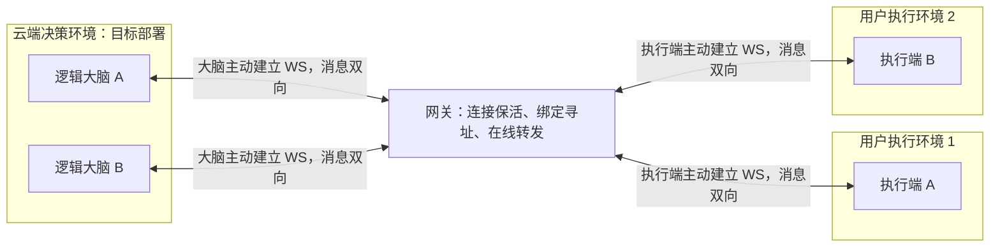

# 云端决策与用户环境执行分离实验：需求梳理

- 日期：2026-10-17
- 状态：核心语义已确认；首轮按最小实验收敛，工程选择见配套设计。
- 当前交付：已完成[一对闭环与本地／远程对照](./step-1-results.md)、[两组并发隔离](./step-2-pair-isolation-results.md)、[明确断线后的失败、取消和有限重连](./disconnect-reconnect-results.md)、[心跳与静默失联检测](./heartbeat-silent-loss-results.md)、[工具忽略取消时的执行槽占用验证](./uncancellable-tool-results.md)，以及[epoch 切换与迟到事件验证](./epoch-late-events-results.md)。CLI 使用两个独立 Brain 进程；M4、M5 通过单进程内的真实 WS 自动测试验证。调用超时与结果竞争等剩余故障验收仍是后续范围。
- 配套文档：[技术设计与实施计划](./technical-design-and-implementation-plan.md)。
- 本次修订：按最新反馈移除结果缓存、恢复查询、去重结果缓存、调用重放和调用数据持久化要求。中断的调用按失败结束，重连只恢复后续通信能力。

## 1. 实验目标

验证智能体的决策与执行可以分开部署：大脑在云端决策，手脚安装在用户提供的执行环境中。双方均主动向网关建立出站 WebSocket 连接，经由网关完成工具调用与结果回传。

角色名称统一为：大脑 Brain、执行端 Executor、网关 Gateway。

**核心目标是让大脑使用远程执行能力时，尽可能保持本地执行与决策一体时的调用体验。**连接、逻辑寻址和有限重连应由通信基础设施封装，大脑的决策逻辑不应到处处理这些细节。

网关职责尽可能窄：维护 WS 连接与保活，根据一对一绑定关系在线转发，允许多组绑定同时工作。它不承担任务管理、业务缓存、失败恢复或持久化。

透明转发的含义是：请求或结果当次能发就发，无法发送就结束本次转发；不暂存等待对端上线或重连，不自动重试。连接恢复只服务新调用，两端通信实现同样不得缓存旧业务消息等待补发。

**已确认的首轮范围：**本机启动独立的网关、模拟大脑和模拟执行端进程，以模拟工具验证通信、配对及故障行为。云端与用户环境分别部署属于目标架构，跨主机验收安排在下一步。

**最小实施边界：**先跑通一对，再用两组绑定验证隔离；只做 echo、wait 两个模拟工具及必要的故障检查。采用一个程序、三个角色入口，不建设通用 SDK、实验平台或完整产品工程。两组与两个工具是简化后的实施默认值，不是额外业务需求。

## 2. 已确认需求

| 编号 | 需求 | 确认内容 |
| --- | --- | --- |
| R1 | 决策与执行分离 | 大脑负责决策，手脚负责工具执行；目标部署位置分别为云端与用户提供的环境。 |
| R2 | 双方主动出站连接 | 大脑、执行端分别连接网关；执行环境无需开放供大脑访问的入站服务端口。 |
| R3 | 双向通信与保活 | 同一 WS 连接支持双向消息，系统能够识别失联。 |
| R4 | 一对一逻辑绑定 | 逻辑智能体实例 ↔ 执行端实例；一个云端服务可运行多个逻辑大脑。 |
| R5 | 多组绑定同时存在 | 不同绑定独立寻址、同时在线、互不串线。 |
| R6 | 手工配置绑定和凭证 | 为大脑侧与执行端侧分别配置凭证；首轮不支持运行中换绑。 |
| R7 | 网关职责尽可能窄 | 连接维护、逻辑寻址、在线转发；不参与工具业务和智能体决策。 |
| R8 | 无业务缓存与持久化 | 不缓存调用或结果，不建立恢复查询、重放或持久化机制。 |
| R9 | 中断调用按失败结束 | 调用被连接中断打断后终止等待并报失败；重连不能使旧调用重新生效。 |
| R10 | 有限重连 | 任一端失联后进行有边界的重连；不无限后台重试。次数与总时限在实施时配置。 |
| R11 | 离线拒绝新调用 | 对端不可达时明确失败，不积压、不等对端上线后自动执行。 |
| R12 | 首轮模拟实验 | 模拟大脑、模拟工具、本机独立进程；跨主机验收为下一步。 |
| R13 | 统一工具调用接口 | 本地直接执行，远程由薄适配层经网关调用；大脑决策代码不处理 WS、寻址与重连。 |
| R14 | 失联或代次变化后尝试取消执行 | 执行端发现失联，或当前通道代次已不同于调用所属代次时，主动取消旧调用的执行上下文、尽量退出；无法停止的操作仍可能完成，不恢复或补发结果。 |

以当前确认为准：中断调用失败、执行端尝试取消、不恢复旧结果。取消是尽力而为，不能从“调用失败”推导出“工具已经停止”。

## 3. 角色与连接模型

双向箭头表示连接建立后消息可双向流动；连接发起方向始终为“大脑 → 网关”和“执行端 → 网关”。A 只与 A 通信，B 只与 B 通信。

首轮在同一台机器上用独立进程复现上述角色，仍须实际经过 WS 与网关，不能通过进程内直连绕过网关。多个逻辑大脑可以由一个模拟大脑进程承载；多个执行端实例可以使用独立进程验证隔离。

| 角色 | 职责 |
| --- | --- |
| 大脑业务逻辑 | 决策、调用工具、消费成功或失败结果。 |
| 大脑侧通信适配层 | 建立连接、关联当前调用的请求与响应、处理超时和连接失败，向大脑暴露统一工具接口。 |
| 执行端 | 建立连接，接收当前有效通道上的调用，执行工具并在线返回结果；发现失联后尝试取消，不保存结果用于重连恢复。 |
| 网关 | 按配置验证端点身份与绑定，维持连接和保活，维护在线路由，转发当前有效通道的数据及必要的连接状态。 |

首轮建议每个逻辑端点使用独立 WS 连接，不要求一条 WS 复用多个身份。

## 4. “像本地调用”的体验边界

### 4.1 已确认的接口与验收目标

大脑通过统一工具调用接口使用执行能力。切换本地执行或远程执行时，只改变执行器配置，不修改规划、决策与工具结果消费逻辑。

例如，同一份模拟大脑代码调用同一个工具与参数：本地模式由本地执行器直接执行；远程模式由薄适配层经网关转发到执行端。大脑得到一致的工具返回结构与明确的失败形式。

网关保持转发职责；端点适配层负责把当前请求与返回结果关联起来。网关不需要知道工具名称的含义、解析工具参数或保存调用生命周期。

### 4.2 不能屏蔽的事实

- 远程连接会产生额外时延、断线及超时；可以统一错误接口，不能保证其行为与进程内函数调用完全相同。
- 请求发送成功不等于工具执行成功，只有收到当前调用有效的最终结果才可判断业务成功。
- **调用因断线失败，不代表执行端没有执行或已完成回滚。**已经开始的操作可能仍在进行，也可能已经完成但结果未送达。
- 不做缓存、查询和持久化后，旧调用的最终执行结果可能永久无法获知；系统仍按已确认要求将该调用以失败结束。
- 自动连接重建与自动重试工具调用是不同动作。前者有限执行，后者不做。

## 5. 绑定、身份与逻辑寻址

### 5.1 已确认的绑定规则

- 每个有效绑定包含一个逻辑大脑身份与一个逻辑执行端身份。
- 任一端点身份同时最多属于一个有效绑定。
- 手工配置绑定，为两端分别配置凭证；运行中不变更绑定。
- 断线不删除静态绑定，不把调用分配给其他执行端。
- 端点只能与自己绑定的对端通信；客户端提交的目标标识不能绕过身份与绑定校验。

### 5.2 建议的最小路由信息

以下是语义名称，不是已冻结的协议字段。

| 信息 | 用途与归属 |
| --- | --- |
| 逻辑端点身份 | 稳定且不随 WS 重连改变；最小版直接使用 `(pair_id, role)`，不另设多套身份编号。 |
| `pair_id` | 标记一对绑定；不作为访问凭证。 |
| 当前 socket | 在本进程中区分旧连接与新连接，防止旧关闭事件删除新路由；不要求另设线上连接编号。 |
| 通道代次 | 任一端重新接入形成新通道时更新；执行侧将调用绑定到接收时的代次，发现不再匹配就取消其执行上下文，旧结果不能进入新通道。 |
| `request_id` | 由端点关联当前在途请求和响应；网关不建立调用历史或结果表。 |

建议使用“认证身份 → 固定绑定 → 对端当前有效连接”的路由路径；网关仅检查必要的转发外层信息，原样转发工具业务内容。

同一身份不能同时有两个有效连接。首轮建议拒绝第二条并发连接，旧连接被判定失效后允许重新注册；必须避免旧连接的迟到消息和清理事件影响新连接。具体策略应与保活、重连窗口配套确定。

## 6. 最小调用闭环

1. 网关读取手工配置的绑定和端点凭证。
2. 两端分别主动连接、完成认证；双方在线且绑定一致时，通道可用。
3. 大脑通过调用接口发送请求；对端离线或通道正在重连时，本次调用失败，不排队。
4. 网关检查当前连接与绑定，仅在线转发。
5. 执行端验证模拟工具和参数，执行并返回结果。
6. 大脑侧将返回结果交给当前等待的调用，结束本次调用。
7. 若调用过程中连接中断或等待超时，本次调用以失败结束，释放其等待状态；执行端发现通道失联后尝试取消对应工具。
8. 连接在限定范围内恢复后，只允许发起新的调用；旧调用不重发、旧结果不补发。

首轮只做 echo 和 wait；产品工具正常响应取消，在 M5 测试中注入有限时长忽略取消的 wait，不增加 CLI 模式。用工具启动事件核对有无额外执行，不另外开发失败工具、计数工具或任务记录系统。

最小通信语义建议包括：端点接入、对端可用／失联通知、调用请求、调用结果和错误。心跳用于连接维护；是否需要增量输出另见 Q7。不设结果查询、恢复游标、补发或任务恢复接口。

## 7. 故障、失败与有限重连

### 7.1 调用失败规则

| 场景 | 要求 |
| --- | --- |
| 调用前已知对端离线 | 立即返回不可用；不积压请求。 |
| 当前连接中断、对端失联或网关重启 | 端点将受影响的在途调用以失败结束；存活的调用方不能无限等待。网关只需通知通道状态，不逐个维护业务调用。 |
| 静默网络中断 | 通过保活失联判定或调用超时结束等待；不承诺瞬时发现断线。 |
| 大脑进程退出 | 当前等待随进程结束消失；新进程不恢复旧调用。 |
| 执行端进程退出 | 当前调用失败；没有调用恢复、结果恢复或持久化恢复。 |
| 工具已开始执行后失联 | 调用方按失败结束；执行端发现失联后尝试取消，无法停止的操作仍可能完成；不保存结果等待后续交付。 |
| 调用超时 | 当前调用失败；迟到结果不再改变该调用的终态，也不触发自动重试。 |
| 重连成功 | 恢复绑定对应的在线通道，允许新的请求；不恢复任何旧调用。 |
| 迟到结果或旧通道数据 | 拒绝或丢弃，不能污染新通道、新调用，不能把已失败调用改成成功。 |
| 连接在成功结果交付后中断 | 已成功结束的调用保持成功，只影响未结束及后续调用。 |

调用方统一看到失败，但错误原因建议区分对端离线、连接中断、超时、工具失败和重连耗尽，以便排查与业务处理。这种错误分类不要求网关存储任务状态。

执行端需要识别两种失联：自身到网关的连接断开，以及自身连接仍正常但网关通知绑定的大脑离线。两种情况均对受影响通道的工具尝试取消；不能取消其他绑定的工具。取消由执行端本地处理，不依赖断线后还能送达一条远程取消指令。

执行侧还须记录每次调用所属的通道代次。收到有效的新通道状态时，若代次已不同于在执行调用的代次，就主动取消旧调用的执行上下文、尽量退出；即使没有收到旧通道的离线通知，也应执行这一规则。这里比较的是绑定双方的通道代次，不能只统计执行侧自己的拨号次数，因为大脑重连时执行侧的 socket 可能仍未断开。大脑侧同步结束旧代次的调用等待，不等待旧工具退出。

取消操作不能无限阻塞连接清理和重连。无法取消的工具仍占用真实执行资源，不能在账面上当作已经结束；单调用实验中，旧工具未退出时新的调用应返回忙碌，退出后才释放执行容量。旧工具的迟到结果直接丢弃，已产生的副作用不自动撤回。

### 7.2 有限重连规则

- 两端各自管理到网关的出站连接；只对失效连接重拨，另一端仍健康的连接继续使用。
- 自身连接健康但对端离线时，只在有限期限内等对端恢复；期间新调用立即失败，不挂起排队。
- 重拨次数、单次拨号与等待时间均有边界；耗尽后停止自动恢复，由操作者重启端点。
- 为减少首轮状态复杂度，实施采用本次端点运行的固定重拨额度，成功不重置；暂不做指数退避、抖动和稳定窗口。
- 重连不重发旧请求、输出或结果，也不延续已经失败的等待。错误凭证等明确不可恢复的问题直接失败。

**首轮不承诺恰好执行一次，也不提供跨调用去重。**系统不自动重试旧调用；业务方重新发起调用可能重复产生副作用。

## 8. 网关“无缓存”的具体边界

已确认不做：离线消息队列、待执行任务队列、请求或结果缓存、重放记录、去重结果表、调用历史、恢复查询，以及任何调用数据持久化。两端也不通过结果缓存或落盘补回这些能力。

为了建立和转发当前连接，仍需要最小运行状态：手工配置的绑定与凭证、当前 socket 与在线路由、保活计时及连接代次。端点还需要保存当前正在等待的请求关联；这些状态在调用结束或连接失效时释放，不用于恢复旧调用。

这里的无缓存指无业务存储与延迟交付。WS/TCP 库及操作系统在传输中使用的瞬时字节缓冲不能在物理上消除；实现应限制在途数据与写入等待，不再额外建立可积压业务消息的队列。慢接收方导致转发无法在界限内完成时，应明确失败或关闭受影响连接，不能持续屯积数据。

静态配置文件是用户提供的启动输入，不是运行中的任务持久化。诊断日志只记录连接、绑定和错误等必要元信息，不记录可供恢复的请求参数、工具输出或结果正文；日志不作为补偿或重放来源。

## 9. 最小实验范围

- 一个网关进程、一个大脑进程；先接一个执行端，再扩展为两个执行端进程。大脑进程内分别装配两个逻辑实例。
- 手工配置两组绑定和各端凭证，本机通过真实 WS 完成调用。
- 统一 Call 接口、本地与远程执行器；每组最多一个调用，一次性 JSON 结果。
- 保活、固定额度重连、代次隔离、失联取消、实际执行容量及必要的消息／写入上限。
- 少量可复现的运行步骤和针对性检查，不建设自动实验平台、通用故障设施或报告系统。

本轮不做流式输出、并行工具调用、交互式终端、真实模型、真实 Shell、动态配对、多租户、安装升级或多实例网关。跨主机及其他操作系统在下一步单独验证。

“任何执行环境”仍是兼容方向，本机模拟结果不能直接写成所有环境均支持。

## 10. 最小验收清单

| 编号 | 验证内容 | 通过标准 |
| --- | --- | --- |
| M1 | 一对通信与本地／远程对照 | 同一大脑代码只切换执行器；真实经过 WS 和网关获得相同工具结果。 |
| M2 | 两组隔离、凭证与重复接入 | A、B 同时工作不串线；错误凭证与第二条同身份有效连接被拒绝。 |
| M3 | 失联与恢复 | 旧调用失败、不补发、不重放；恢复后只处理新调用；另一组继续工作。 |
| M4 | 代次变化与迟到事件 | 即使未收到离线通知，新代次也取消旧执行；旧回调不误删新连接，旧结果不污染新调用。 |
| M5 | 无法取消的工具 | 真实执行槽在工具退出前保持占用；新调用忙碌，旧结果丢弃，退出后容量恢复。 |
| M6 | 有限重拨、超时与终态 | 重拨耗尽就停止；调用超时后不被迟到成功改写，只结束一次。 |

用例的本机操作方式见技术设计第 7 节。首轮不要求 10 组绑定、1,000 次调用、完整资源基准或自动报告；仍须保留消息大小和写入时限等简单边界。

## 11. 确认记录与后续细化项

### 11.1 已确认

| 编号 | 议题 | 最新结论 |
| --- | --- | --- |
| Q1 | 绑定粒度 | 逻辑智能体实例 ↔ 执行端实例。 |
| Q2 / Q5 | 实验与工具范围 | 首轮模拟大脑和模拟工具。 |
| Q3 / Q8 | 断线、缓存与恢复 | 中断调用按失败结束；有限重连；无业务缓存、查询、重放和持久化。取代前轮的重连查询方案。 |
| Q4 | 配对配置 | 手工配置绑定及两端独立凭证，运行中不换绑。 |
| Q9 | 首轮部署 | 本机独立进程；跨主机验收为下一步。 |
| Q11 | 本地调用体验 | 统一工具调用接口与薄适配层；大脑决策代码不处理 WS、寻址和重连。 |
| Q12 | 失联或代次变化后的工具执行 | 执行端主动取消旧调用的执行上下文、尽量退出；不依赖旧通道通知必达，不保证强制清理，工具退出前仍占用容量，旧结果不补发。 |

### 11.2 已按最小默认收敛的工程选择

- 流式输出、单绑定并行调用与交互式终端本轮不做；使用单调用、一次性结果。
- 多租户、动态凭证管理、安装包和后台服务本轮不做。
- 首轮采用固定计时和大小常量；实现时可以调整，不为此建设配置体系。
- 网关无缓存仍需要瞬时传输缓冲与当前连接路由状态，边界见第 8 节。

上述工程选择无需再次逐项提问。当前没有阻塞最小实验开工的新业务决策；真实部署和工具接入的信息到下一阶段再确定。

## 12. 分步实施与停止边界

1. 先交付一对独立进程的本地／远程闭环，不提前铺完整工程。
2. 再增加第二对及故障规则，逐项验证隔离、取消与代次处理。
3. 完成六组轻量验收，记录结论，最小实验到此停止。

每步先有可运行、可检查的成果再推进；本次只更新需求与设计，不开始代码实现。缓存、重放和持久化不属于本实验；也不承诺文档审查可以排除所有未知缺陷。
